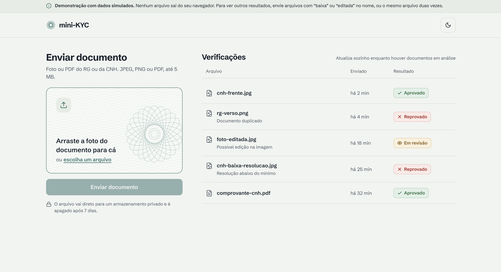
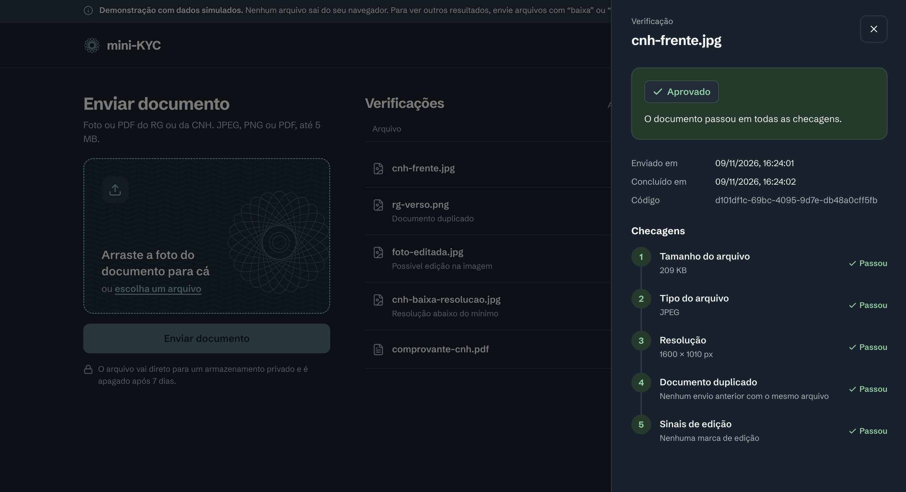
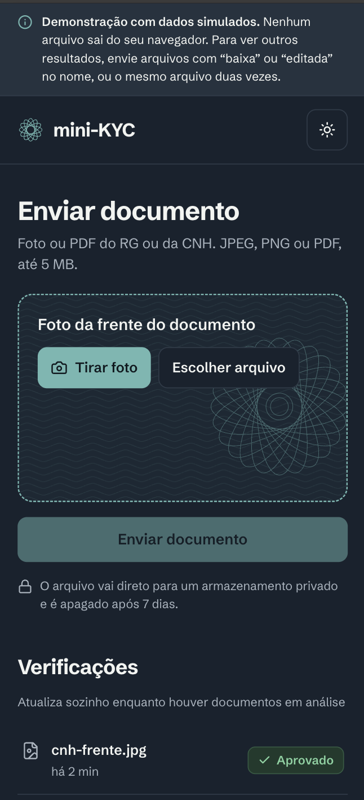

# mini-KYC

Projeto de estudo de React + backend serverless na AWS + NoSQL, simulando um fluxo simplificado
de KYC (*Know Your Customer*): a pessoa envia a foto de um documento, o sistema roda checagens
automáticas de forma assíncrona e devolve um resultado com o motivo.

**[Ver a demo](https://cvaldrighi.github.io/mini-KYC/)**: o frontend publicado no GitHub Pages,
no modo mock (dados simulados, nada sai do navegador). O backend roda na AWS sob demanda, com
`npm run up` (ver "Backend na AWS").



<table>
  <tr>
    <td width="72%"></td>
    <td width="28%"></td>
  </tr>
  <tr>
    <td align="center"><sub>Detalhe da verificação, tema escuro</sub></td>
    <td align="center"><sub>Celular, tema escuro</sub></td>
  </tr>
</table>

## Como funciona

```
React ──POST──▶ Lambda create-verification ──▶ DynamoDB (PENDING)
  │                    │
  │◀── presigned URL ──┘
  │
  └──PUT──▶ S3 uploads/ ──evento──▶ Lambda process-document
                                       │  tamanho → tipo → resolução → duplicidade → edição
                                       └──▶ DynamoDB (APPROVED | REJECTED | MANUAL_REVIEW)
React ──GET (a cada 5 s)──▶ Lambda list-verifications ──▶ DynamoDB (GSI por data)
Lambdas ──▶ CloudWatch: logs JSON, métricas EMF, dashboard e alarme
```

- O arquivo vai direto do navegador para o S3 por uma presigned URL, sem passar pela Lambda.
- O processamento é disparado pelo evento do S3, é idempotente e executa checagens em camadas,
  da mais barata para a mais cara. O arquivo só é baixado quando a primeira checagem precisa dele.
- A listagem usa um índice secundário (GSI) ordenado por data, com paginação por cursor.

| Checagem | Reprova ou revisa quando |
|---|---|
| Tamanho | menor que 10 KB ou maior que 5 MB (sem baixar o arquivo) |
| Tipo real | os primeiros bytes não são JPEG, PNG ou PDF, ou não batem com o tipo declarado |
| Resolução | lado maior abaixo de 600 px ou lado menor abaixo de 400 px (PDF passa) |
| Duplicidade | o mesmo arquivo (SHA-256) já foi usado em outra verificação |
| Sinal de edição | o EXIF indica um editor de imagem (revisão manual, não reprovação) |

## Stack

- **Frontend**: React 19, TypeScript, Vite, Tailwind CSS v4, shadcn/ui (Radix), Jest e React Testing Library.
- **Backend**: Node.js 22 (ARM), TypeScript, AWS Lambda com Function URLs, S3, DynamoDB,
  CloudWatch, AWS Lambda Powertools, AWS SAM, Jest e aws-sdk-client-mock.

## Estrutura

```
frontend/   aplicação React (src/api, components, hooks, lib, domain)
backend/    Lambdas (src/functions), checagens (src/checks), repositórios, template SAM
            e arquivos de exemplo para os testes (fixtures/)
docs/       acessibilidade, critérios de aceite, consultas do Logs Insights, runbook e incidentes
openspec/   especificação (OpenSpec): proposta, specs, design e tarefas
```

## Como rodar

Requisitos: Node.js 22+. Para a AWS: AWS CLI v2, SAM CLI e esbuild (`brew install esbuild`).

### Frontend sem backend

```bash
cd frontend
cp .env.example .env   # VITE_API_MODE=mock: tudo em memória
npm install
npm run dev            # http://localhost:5173
npm test
```

No modo mock, o resultado depende do nome do arquivo: "baixa" reprova por resolução, "editada"
manda para revisão, "renomeado" reprova pelo tipo, "erro" simula falha no processamento.

### Backend na AWS

```bash
cd backend
npm install
npm test
npm run up             # deploy (stack "mini-kyc" em sa-east-1) e escreve o frontend/.env
```

O `npm run up` faz o `sam build` e o `sam deploy` e depois escreve no `frontend/.env` as duas
Function URLs dos *Outputs*, com `VITE_API_MODE=aws`. Reinicie o `npm run dev` do frontend.
Separados: `npm run deploy` e `npm run env:frontend`. O CORS libera só `http://localhost:5173` (parâmetro `FrontendOrigin`).
Para receber o alarme por e-mail: `sam deploy --parameter-overrides FrontendOrigin=http://localhost:5173 AlarmEmail=voce@exemplo.com`.

### Demo no GitHub Pages

O workflow `.github/workflows/deploy-frontend.yml` roda os testes, gera o build no modo mock e
publica no GitHub Pages a cada mudança do frontend na `master`. Pré-requisito, uma única vez:
Settings › Pages › Build and deployment › Source: **GitHub Actions**.

### Apagar tudo da AWS

```bash
cd backend
npm run destroy        # esvazia o bucket, roda sam delete e volta o frontend/.env para mock
```

O CloudFormation não apaga um bucket com arquivos, por isso o script esvazia o bucket antes.
Para recriar tudo depois: `npm run up` (as Function URLs mudam, e o `.env` é atualizado sozinho).

## Decisões e trade-offs

| Decisão | Por quê | Custo ou alternativa |
|---|---|---|
| Upload direto para o S3 com presigned URL | O arquivo não passa pela Lambda: sem limite de payload, menos tempo e custo | A presigned URL de PUT não limita tamanho; o limite é checado no processamento |
| Function URLs em vez de API Gateway | Zero custo extra e menos configuração | Sem autenticação nem rate limit; em produção, API Gateway com autorizador |
| Processamento disparado por evento do S3 | O cliente não espera; o S3 garante a entrega | Entrega "pelo menos uma vez": exige idempotência |
| Idempotência por escrita condicional (`status = PENDING`) | Eventos duplicados não sobrescrevem um resultado | Uma leitura extra para descartar eventos repetidos antes de rodar o pipeline |
| Pipeline de checagens em uma Lambda, e não Step Functions | As checagens levam milissegundos e usam o mesmo arquivo em memória | Step Functions faria sentido com etapas lentas ou humanas (IA, revisão manual) |
| Unicidade do hash numa tabela própria | O DynamoDB só garante unicidade na chave primária | Single-table design seria mais eficiente, mas menos didático |
| Listagem por GSI com partition key fixa | `Query` ordenada em vez de `Scan` | Partição quente com volume alto; num sistema real, a chave seria o cliente |
| Tipo e resolução lidos dos bytes, sem bibliotecas | Só três formatos; `file-type` é só ESM e não roda no Jest em CommonJS | Mais código próprio (com testes) |
| Erro de documento vira revisão; erro de infraestrutura falha a invocação | Retry e alarme só para o que pode se resolver sozinho | Definido a partir do [incidente 01](docs/incidente-01.md) |
| Logs em JSON e métricas em EMF (Powertools) | Campos consultáveis no Logs Insights; métricas sem chamada de API | Sem dimensão por `verificationId`, para não multiplicar o custo das métricas |
| Infraestrutura como código (SAM) | Reprodutível, versionada e revisada em PR | — |
| Tipos de domínio duplicados no frontend e no backend | Sem configurar monorepo com workspaces | Precisam ser mantidos em sincronia à mão |

## Observabilidade

- **Dashboard** `mini-kyc` no CloudWatch (link no output `DashboardUrl`): volume por status,
  duração do pipeline, invocações, erros, latência, throttles, alarme e últimos erros.
- **Consultas prontas** em [docs/logs-insights.md](docs/logs-insights.md).
- **Runbook** em [docs/runbook.md](docs/runbook.md).
- **Incidente simulado** em [docs/incidente-01.md](docs/incidente-01.md).

## Próximos passos

- **Revisão manual:** endpoint e tela para um analista aprovar ou reprovar as verificações em
  `MANUAL_REVIEW`.
- **Verificação por IA:** uma nova `VerificationCheck` no fim do pipeline, chamando um modelo com
  visão, com timeout, fallback para revisão manual e registro de custo por chamada.
- **Destino de falha** (SQS ou `OnFailure`) para eventos que esgotarem as novas tentativas.
- **Alarme de `PROCESSING_ERROR`** para aumento anormal de revisões por erro.
- **API Gateway** com autenticação e rate limit no lugar das Function URLs públicas.

## Especificação

Guiado por especificação com [OpenSpec](https://github.com/Fission-AI/OpenSpec). A mudança está
em `openspec/changes/add-mini-kyc-mvp/`: requisitos e critérios de aceite em `specs/`, decisões
técnicas em `design.md` e o andamento em `tasks.md`. A revisão final dos critérios está em
[docs/criterios-de-aceite.md](docs/criterios-de-aceite.md).
